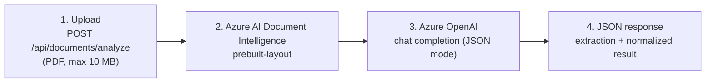

# AzureDocumentAI-DotNet

A small ASP.NET Core Minimal API that turns a business PDF (for example an invoice) into clean, structured JSON.
It uses **Azure AI Document Intelligence** to read the document and **Azure OpenAI** to normalize what was read.

Upload one PDF and get back:
- the extracted **text**, **tables** and **key-value pairs**, and
- an **AI-normalized** summary: document type, parties, dates, totals and key facts.

## Architecture



| Stage | What happens | Code |
|---|---|---|
| 1. Upload | Checks that a file is present, is a real PDF and is 10 MB or smaller | `Program.cs` |
| 2. Document Intelligence | Extracts text, tables (rows × cells) and key-value pairs | `Services/DocumentAnalysisService.cs` |
| 3. Azure OpenAI | Turns a size-limited summary of the extraction into normalized JSON | `Services/AzureOpenAiService.cs` |
| 4. Response | Returns one JSON payload with both results | `Models/DocumentAnalysisResponse.cs` |

### Document Intelligence vs. the LLM

| Azure AI Document Intelligence | Azure OpenAI (LLM) |
|---|---|
| **Reads** the document: OCR, layout, reading order | **Interprets** what was read |
| Finds tables and their cells exactly as laid out | Decides what kind of document it is |
| Finds labelled key-value pairs (`Invoice No: INV-1`) with confidence scores | Works out who the parties are and their roles (seller, buyer) |
| Deterministic and grounded in the page | Groups dates and totals, writes a short summary and key facts |
| Doesn't understand meaning | Only sees the extraction, never the PDF; told to use only that content and never guess |

The LLM's reply is parsed and checked. If the reply is malformed, empty, cut off or blocked by the content filter,
the request still succeeds, with `aiNormalized.success: false` and an explanation.

## Tech stack

- .NET 10, ASP.NET Core Minimal API
- [Azure.AI.DocumentIntelligence](https://www.nuget.org/packages/Azure.AI.DocumentIntelligence) 1.0.0 (`prebuilt-layout` model)
- [Azure.AI.OpenAI](https://www.nuget.org/packages/Azure.AI.OpenAI) 2.1.0 (chat completions)
- Swashbuckle (Swagger UI)

## Prerequisites

- [.NET 10 SDK](https://dotnet.microsoft.com/download)
- An Azure subscription with:
  - an **Azure AI Document Intelligence** resource (F0 free tier is enough to try it)
  - an **Azure OpenAI** or **Azure AI Foundry** resource with a deployed chat model (tested with `gpt-5`; `gpt-4o-mini` and `gpt-4.1-mini` also fit)

## Azure resource setup

1. **Document Intelligence:** Azure portal → **Create a resource** → *Document Intelligence* → create it.
   Then open it → **Keys and Endpoint** → copy **Endpoint** and **KEY 1**.
2. **Azure OpenAI / Foundry:** create an Azure OpenAI or Azure AI Foundry resource.
   - Open it → **Keys and Endpoint** → copy **KEY 1** and the **Azure OpenAI endpoint** (`https://<name>.openai.azure.com/`).
3. **Model deployment:** in the [Azure AI Foundry portal](https://ai.azure.com) → **Models + endpoints** → **Deploy model**.
   Pick a chat model and note the **deployment name** (the *Name* column, not the model name).

## Configuration

The app reads five settings. It uses .NET configuration, so you can provide them as **environment variables** or as
**.NET User Secrets** (local development). See [`.env.example`](AzureDocumentAI-DotNet/.env.example).

| Setting | Example |
|---|---|
| `DOCUMENT_INTELLIGENCE_ENDPOINT` | `https://<name>.cognitiveservices.azure.com/` |
| `DOCUMENT_INTELLIGENCE_KEY` | key from the portal |
| `AZURE_OPENAI_ENDPOINT` | `https://<name>.openai.azure.com/` |
| `AZURE_OPENAI_API_KEY` | key from the portal |
| `AZURE_OPENAI_DEPLOYMENT` | your deployment name, e.g. `gpt-5-mydeployment` |

**Recommended: User Secrets.** The values are stored in your user profile, outside the repo:

```powershell
cd AzureDocumentAI-DotNet
dotnet user-secrets set "DOCUMENT_INTELLIGENCE_ENDPOINT" "https://<name>.cognitiveservices.azure.com/"
dotnet user-secrets set "DOCUMENT_INTELLIGENCE_KEY" "<key>"
dotnet user-secrets set "AZURE_OPENAI_ENDPOINT" "https://<name>.openai.azure.com/"
dotnet user-secrets set "AZURE_OPENAI_API_KEY" "<key>"
dotnet user-secrets set "AZURE_OPENAI_DEPLOYMENT" "<deployment-name>"
```

In Visual Studio, you can instead right-click the project → **Manage User Secrets**.

If any setting is missing, the app stops at startup and names the missing settings. Never put keys in `appsettings.json`,
`launchSettings.json` or a committed `.env` file.

## Run it

```powershell
cd AzureDocumentAI-DotNet
dotnet restore
dotnet build
dotnet run --launch-profile http
```

`dotnet run` must be run inside `AzureDocumentAI-DotNet/`. From the repo root, use
`dotnet run --project AzureDocumentAI-DotNet --launch-profile http`.
In Visual Studio, open `AzureDocumentAI-DotNet.sln` and press **F5**.

### Test it

- **Swagger UI:** open <http://localhost:5004/swagger> → **POST /api/documents/analyze** → **Try it out** → choose a PDF → **Execute**.
- **curl** (from `AzureDocumentAI-DotNet/`):
  ```bash
  curl -F "file=@samples/invoice.pdf" http://localhost:5004/api/documents/analyze
  ```
- **Visual Studio:** open `AzureDocumentAI-DotNet.http` and click **Send request**.

`samples/invoice.pdf` is a synthetic invoice with four line items. All of its names and numbers are made up.
With a reasoning model such as GPT-5, a request takes about 30 seconds.

### Responses

| Status | When |
|---|---|
| `200` | Success. Check `aiNormalized.success` for the LLM step. |
| `400` | No file, empty file, not a PDF, or larger than 10 MB |
| `502` | An Azure service rejected the call or couldn't be reached (check endpoint, key and deployment) |
| `504` | Document Intelligence (2 min) or Azure OpenAI (90 s) took too long |

## Example response

A real response for `samples/invoice.pdf`, shortened (`…`):

```json
{
  "filename": "invoice.pdf",
  "documentIntelligence": {
    "text": "INVOICE\nNorthwind Office Supplies Ltd. 12 Harbour Road, Bristol BS1 4AA, United Kingdom …",
    "tables": [
      {
        "rowCount": 5,
        "columnCount": 5,
        "rows": [
          ["#", "Description", "Qty", "Unit Price", "Amount"],
          ["1", "A4 Copy Paper (box of 5 reams)", "20", "GBP 24.50", "GBP 490.00"],
          ["2", "Ergonomic Office Chair", "4", "GBP 189.00", "GBP 756.00"],
          ["3", "Wireless Keyboard and Mouse Set", "10", "GBP 39.99", "GBP 399.90"],
          ["4", "Whiteboard Markers (pack of 12)", "15", "GBP 8.75", "GBP 131.25"]
        ]
      }
    ],
    "keyValuePairs": [
      { "key": "Invoice No:", "value": "INV-2026-0147", "confidence": 0.996 },
      { "key": "Invoice Date:", "value": "15 October 2026", "confidence": 0.997 },
      { "key": "Subtotal:", "value": "GBP 1,777.15", "confidence": 0.998 }
    ]
  },
  "aiNormalized": {
    "success": true,
    "data": {
      "documentType": "Invoice",
      "summary": "Invoice INV-2026-0147 from Northwind Office Supplies Ltd. to Contoso Manufacturing GmbH for office supplies totaling GBP 2,132.58, due 14 November 2026.",
      "parties": [
        { "role": "Seller", "name": "Northwind Office Supplies Ltd.", "details": "12 Harbour Road, Bristol BS1 4AA, United Kingdom VAT No: GB123456789" },
        { "role": "Bill To", "name": "Contoso Manufacturing GmbH", "details": "Attn: Accounts Payable; Industriestrasse 5, 70173 Stuttgart, Germany" }
      ],
      "dates": [
        { "label": "Invoice Date", "value": "15 October 2026" },
        { "label": "Due Date", "value": "14 November 2026" }
      ],
      "totals": [
        { "label": "Subtotal", "amount": "GBP 1,777.15", "currency": "GBP" },
        { "label": "VAT (20%)", "amount": "GBP 355.43", "currency": "GBP" },
        { "label": "Total Due", "amount": "GBP 2,132.58", "currency": "GBP" }
      ],
      "keyFacts": ["Invoice No: INV-2026-0147", "PO Number: PO-88231", "Payment Terms: Net 30", "…"]
    }
  }
}
```

If the LLM's reply can't be used, `aiNormalized` looks like this instead:

```json
{ "success": false, "error": "Azure OpenAI returned malformed JSON.", "rawResponse": "…" }
```

## Project structure

```
AzureDocumentAI-DotNet.sln
AzureDocumentAI-DotNet/
  Program.cs                          endpoint, validation, error handling
  Services/DocumentAnalysisService.cs Document Intelligence (prebuilt-layout)
  Services/AzureOpenAiService.cs      prompt, LLM call, JSON parsing
  Models/AzureSettings.cs             loads and checks the five settings
  Models/DocumentAnalysisResponse.cs  response shape
  samples/invoice.pdf                 synthetic test invoice
  .env.example                        setting names, placeholder values
```

## Limitations

This is a demo MVP, not a production service:

- **Access and storage:** no authentication, rate limiting or persistence. Nothing is saved.
- **Request handling:** one PDF per request, processed synchronously; large documents can take a while.
- **Size limits:** the LLM sees at most 12,000 characters of text, 10 tables × 50 rows and 100 key-value pairs. Longer documents are marked as truncated in the prompt.
- **Value format:** amounts and dates are returned as strings copied from the document, not parsed into numbers or ISO dates.
- **Key-value quality:** depends on the layout model. Tables are sometimes also reported as key-value pairs.
- **LLM output:** may vary between runs; there is no schema-level validation beyond the expected top-level fields.
- **Tests:** there's no automated test suite.

## Attribution

Functionally inspired by [Sandesh-hase/SupplyChain-Document-Intelligence](https://github.com/Sandesh-hase/SupplyChain-Document-Intelligence)
(Python / FastAPI). This is a fresh .NET implementation; no code was copied.

## License

[MIT](LICENSE)
